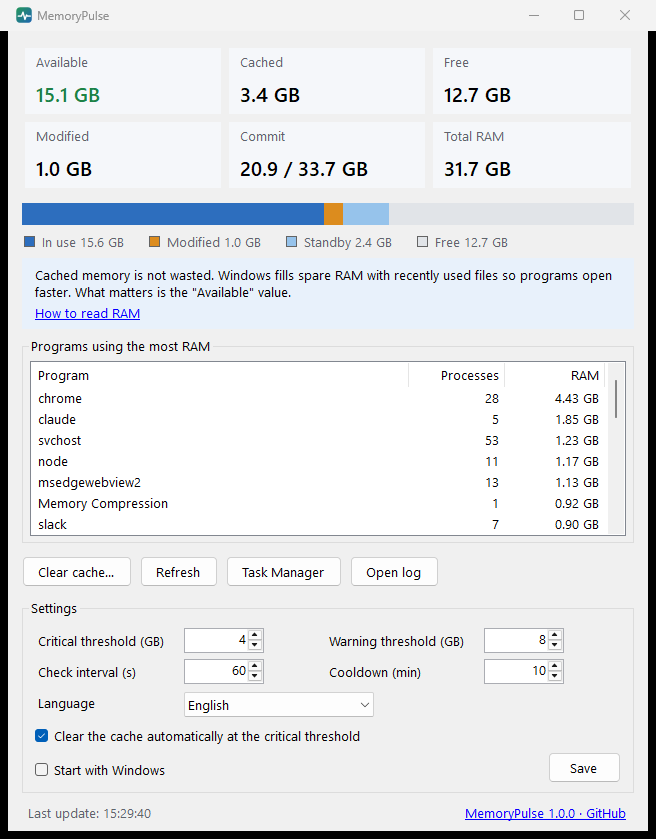

# MemoryPulse

**See what is really using your RAM, and learn why cached memory is not wasted.**

[Türkçe](README.tr.md)



MemoryPulse is a small Windows tray app (about 85 KB, no installer) that shows your memory the way Windows actually uses it. It explains each value in plain words, warns you only when memory is really running low, and tells you which programs are using the most.

## Why

"My RAM is 90% full!" is one of the most common PC worries, and usually a false alarm. Windows fills spare RAM with copies of recently used files and programs (the *cached* or *standby* memory) so they open faster. That memory is handed back to any program that asks for it, instantly. Many "RAM cleaner" tools empty this cache, which makes the numbers look better and the PC slower, because everything has to be read from disk again.

MemoryPulse does the opposite: it teaches you to read the numbers, and only steps in when there is a real shortage.

## Features

- **Live memory view:** available, cached (standby + modified, the same value as *Cached* in Task Manager), free, modified, commit and total RAM, with a tooltip explaining each one.
- **Programs using the most RAM,** grouped by program name.
- **Where each program runs from:** double-click a program (or right-click → *Details*) to see every running copy with its file location, description, publisher and working folder. For programs whose name says little on its own (node, python, java, PowerShell, WebView2, svchost…) it also shows the command line, so you can tell which script, app or Windows service is using the memory. *Open file location* jumps to it in Explorer.
- **Tray icon that shows the state:** normal, amber below the warning threshold, red below the critical threshold.
- **Notification at the critical threshold** listing the top programs, so you know what to close.
- **Cache clearing only when you need it:** manually (with an explanation of why it is rarely needed) or automatically at the critical threshold.
- **Start with Windows** option.
- **Check for updates:** click the link in the window or the tray menu and MemoryPulse asks GitHub for the latest version number in the background, then tells you whether you are up to date. The download page opens only if a newer version exists and you choose to open it. To get an e-mail when a new version is out, choose *Watch → Custom → Releases* on the [GitHub page](https://github.com/ahmetunaluzun/MemoryPulse).
- **English and Turkish.** Follows the Windows language by default; can be changed in settings.
- **Light:** about 26 MB of private memory while sitting in the tray.

## Download and run

1. Download `MemoryPulse.exe` from the [latest release](../../releases/latest).
2. Run it. No installation is needed; .NET Framework 4.8 is already part of Windows 10 and 11.
3. The window opens; closing it keeps MemoryPulse in the notification area. Right-click the icon for the menu.

**Windows SmartScreen warning:** the exe is not code-signed, so Windows may show "Windows protected your PC" the first time. Click *More info* → *Run anyway*. If you prefer, build it yourself from source (see below); every release also lists the SHA-256 checksum of the exe.

**Requirements:** Windows 10 or 11, .NET Framework 4.8 (built in).

## Settings

| Setting | Default | What it does |
|---|---|---|
| Critical threshold | 4 GB | Below this much available RAM: red icon, notification, optional automatic cache clearing |
| Warning threshold | 8 GB | Below this much available RAM: amber icon |
| Check interval | 60 s | How often memory is measured in the background |
| Cooldown | 10 min | Minimum time between two notifications |
| Clear the cache automatically | On | Clears the cache at the critical threshold (needs *Start with Windows*, see below) |
| Start with Windows | Off | Starts MemoryPulse in the tray when you sign in |
| Language | Automatic | Windows language, English or Turkish |

Settings and the log are stored in `%APPDATA%\MemoryPulse\` (`settings.json`, `memorypulse.log`).

## Privacy

MemoryPulse collects **no telemetry** and never connects anywhere on its own. Its only network connection is *Check for updates*, and only when you click it: it asks GitHub (`api.github.com`) for the number of the latest release. Nothing about your PC or its memory is sent; as with any web request, GitHub sees the request's IP address. Everything else stays on your PC: the settings file and a local log.

The details window shows paths and command lines only on screen; they are never written to the log or settings. Values that look like passwords, tokens or keys in a command line are hidden (`****`), but this is a best-effort filter: check before sharing a screenshot of the details window.

## How it works

| What | Windows API |
|---|---|
| Total, available memory and commit | `GlobalMemoryStatusEx` |
| Standby, modified and free page lists | `NtQuerySystemInformation(SystemMemoryListInformation)` |
| Clearing the cache (standby list) | `NtSetSystemInformation(SystemMemoryListInformation, MemoryPurgeStandbyList)` |
| Programs using the most RAM | Process working sets, grouped by name |

- MemoryPulse runs **without administrator rights**. Clearing the cache needs them, so when you ask for it MemoryPulse starts a second copy of itself with `--purge-standby` and Windows asks for permission (UAC).
- **Start with Windows** creates a scheduled task named `MemoryPulse` that runs at sign-in with highest privileges. You approve this once; after that, automatic cache clearing works without a prompt each time.
- When the window is closed, it is fully released and MemoryPulse trims its own memory.

## Build from source

Requirements: a current .NET SDK (tested with 10.0; the project targets .NET Framework 4.8, which is included in Windows).

```
git clone https://github.com/ahmetunaluzun/MemoryPulse.git
cd MemoryPulse
dotnet build src\MemoryPulse\MemoryPulse.csproj -c Release
```

The exe is created at `src\MemoryPulse\bin\Release\net48\MemoryPulse.exe`.

## Adding a language

1. Copy `src/MemoryPulse/Lang/en.json` to `src/MemoryPulse/Lang/<code>.json` (for example `de.json`).
2. Set `_name` (shown in the language list) and `_culture` (for example `de-DE`), then translate the values. Keep the keys and the `{0}` placeholders as they are.
3. Build. Language files are embedded in the exe, so it stays a single file.

Pull requests with new languages are welcome.

## License

[MIT](LICENSE)
