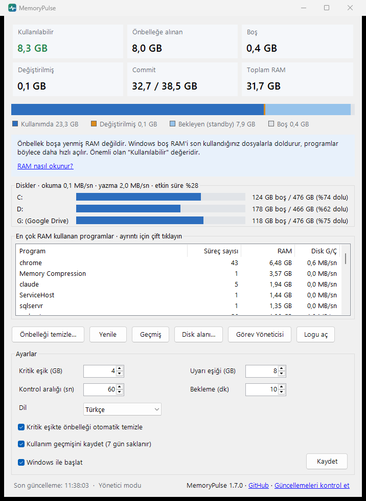

# MemoryPulse

**RAM'inizi gerçekte neyin kullandığını görün; önbellekteki belleğin neden boşa gitmediğini öğrenin.**

[English](README.md)



MemoryPulse, Windows bildirim alanında duran küçük bir uygulama (yaklaşık 85 KB, kurulum yok). Belleği Windows'un gerçekte kullandığı biçimde gösterir, her değeri sade bir dille açıklar, yalnız bellek gerçekten azaldığında uyarır ve en çok belleği hangi programların kullandığını söyler.

## Neden

"RAM'im %90 dolu!" bilgisayarla ilgili en sık duyulan endişelerden biri ve çoğu zaman boş yere. Windows boştaki RAM'i son kullanılan dosya ve programların kopyalarıyla doldurur (*önbelleğe alınan* ya da *bekleme* belleği), böylece onlar daha hızlı açılır. Bir program bellek istediğinde Windows bu alanı anında geri verir. Birçok "RAM temizleyici" bu önbelleği boşaltır; rakamlar iyi görünür ama bilgisayar yavaşlar, çünkü her şeyin diskten yeniden okunması gerekir.

MemoryPulse bunun tersini yapar: rakamları okumayı öğretir ve yalnız gerçek bir sıkışıklıkta devreye girer.

## Özellikler

- **Anlık bellek görünümü:** kullanılabilir, önbelleğe alınan (bekleme + değiştirilmiş; Görev Yöneticisi'ndeki *Önbelleğe alınan* ile aynı değer), boş, değiştirilmiş, ayrılan (commit) ve toplam RAM. Her birinin üzerine gelince açıklaması çıkar.
- **En çok RAM kullanan programlar,** program adına göre gruplanmış.
- **Programın nereden çalıştığı:** bir programa çift tıklayın (ya da sağ tık → *Ayrıntılar*). Çalışan her kopyası dosya konumu, açıklaması, yayıncısı ve çalışma klasörüyle listelenir. Adı tek başına bir şey anlatmayan programlarda (node, python, java, PowerShell, WebView2, svchost…) komut satırı da görünür; böylece belleği hangi betiğin, uygulamanın ya da Windows hizmetinin kullandığını anlarsınız. *Dosya konumunu aç* dosyayı Gezgin'de gösterir.
- **Durumu gösteren simge:** normalde düz, uyarı eşiğinin altında turuncu, kritik eşiğin altında kırmızı.
- **Kritik eşikte bildirim:** en çok bellek kullanan programları listeler, neyi kapatabileceğinizi görürsünüz.
- **Önbellek temizliği yalnız gerektiğinde:** elle (neden nadiren gerektiğini anlatan bir onayla) ya da kritik eşikte otomatik.
- **Windows ile başlat** seçeneği.
- **Yeni sürüm bildirimi:** MemoryPulse günde bir kez GitHub'dan en son sürümün numarasını sorar, yeni sürüm çıkınca haber verir (kapatılabilir).
- **Türkçe ve İngilizce.** Varsayılan olarak Windows diline göre açılır, ayarlardan değiştirilebilir.
- **Hafif:** bildirim alanında dururken yaklaşık 26 MB özel bellek.

## İndirme ve çalıştırma

1. `MemoryPulse.exe` dosyasını [son sürümden](../../releases/latest) indirin.
2. Çalıştırın. Kurulum gerekmez; .NET Framework 4.8 Windows 10 ve 11'de zaten var.
3. Pencere açılır; kapattığınızda MemoryPulse bildirim alanında kalır. Menü için simgeye sağ tıklayın.

**Windows SmartScreen uyarısı:** exe kod imzalı değil, bu yüzden ilk açılışta "Windows bilgisayarınızı korudu" uyarısı çıkabilir. *Ek bilgi* → *Yine de çalıştır* deyin. İsterseniz kaynaktan kendiniz derleyin (aşağıda); her sürümde exe'nin SHA-256 özeti de yazılıdır.

**Gereksinimler:** Windows 10 veya 11, .NET Framework 4.8 (Windows'ta hazır).

## Ayarlar

| Ayar | Varsayılan | Ne yapar |
|---|---|---|
| Kritik eşik | 4 GB | Kullanılabilir RAM bunun altına inerse: kırmızı simge, bildirim, isteğe bağlı otomatik önbellek temizliği |
| Uyarı eşiği | 8 GB | Kullanılabilir RAM bunun altına inerse: turuncu simge |
| Kontrol aralığı | 60 sn | Belleğin arka planda ne sıklıkla ölçüleceği |
| Bekleme süresi | 10 dk | İki bildirim arasındaki en kısa süre |
| Önbelleği otomatik temizle | Açık | Kritik eşikte önbelleği temizler (*Windows ile başlat* gerekir, aşağıya bakın) |
| Windows ile başlat | Kapalı | Oturum açınca MemoryPulse'ı bildirim alanında başlatır |
| Yeni sürümleri denetle | Açık | Günde bir kez GitHub'dan en son sürümün numarasını sorar, yeni sürüm çıkınca bildirim gösterir |
| Dil | Otomatik | Windows dili, Türkçe ya da İngilizce |

Ayarlar ve log `%APPDATA%\MemoryPulse\` altında durur (`settings.json`, `memorypulse.log`).

## Gizlilik

MemoryPulse **telemetri toplamaz**. Tek ağ bağlantısı yeni sürüm denetimidir: günde bir kez GitHub'a (`api.github.com`) en son sürümün numarasını sorar. Bilgisayarınız veya belleğiniz hakkında hiçbir bilgi gönderilmez; GitHub, her web isteğinde olduğu gibi isteğin IP adresini görür. Ayarlardan *Yeni sürümleri denetle* kutusunu kapatırsanız MemoryPulse hiçbir ağ bağlantısı kurmaz. Geri kalan her şey bilgisayarınızda kalır: ayar dosyası ve yerel bir log.

Ayrıntı penceresindeki yollar ve komut satırları yalnız ekranda gösterilir; loga ve ayar dosyasına yazılmaz. Komut satırında parola, token ya da anahtara benzeyen değerler gizlenir (`****`), ancak bu süzgeç her durumu yakalamayabilir: ayrıntı penceresinin ekran görüntüsünü paylaşmadan önce kontrol edin.

## Nasıl çalışır

| Ne | Windows API |
|---|---|
| Toplam ve kullanılabilir bellek, commit | `GlobalMemoryStatusEx` |
| Bekleme, değiştirilmiş ve boş sayfa listeleri | `NtQuerySystemInformation(SystemMemoryListInformation)` |
| Önbelleği (bekleme listesini) temizleme | `NtSetSystemInformation(SystemMemoryListInformation, MemoryPurgeStandbyList)` |
| En çok RAM kullanan programlar | Süreçlerin çalışma kümeleri, ada göre gruplanmış |

- MemoryPulse **yönetici yetkisi olmadan** çalışır. Önbelleği temizlemek için yetki gerekir; bunu istediğinizde MemoryPulse kendisini `--purge-standby` ile ikinci kez başlatır ve Windows izin ister (UAC).
- **Windows ile başlat**, oturum açılışında en yüksek yetkiyle çalışan `MemoryPulse` adlı bir zamanlanmış görev oluşturur. Bunu bir kez onaylarsınız; sonra otomatik temizlik her seferinde izin sormadan çalışır.
- Pencere kapandığında tamamen serbest bırakılır ve MemoryPulse kendi belleğini küçültür.

## Kaynaktan derleme

Gereksinim: güncel bir .NET SDK (10.0 ile denendi; proje Windows'ta hazır gelen .NET Framework 4.8'i hedefler).

```
git clone https://github.com/ahmetunaluzun/MemoryPulse.git
cd MemoryPulse
dotnet build src\MemoryPulse\MemoryPulse.csproj -c Release
```

Exe `src\MemoryPulse\bin\Release\net48\MemoryPulse.exe` yolunda oluşur.

## Dil ekleme

1. `src/MemoryPulse/Lang/en.json` dosyasını `src/MemoryPulse/Lang/<kod>.json` olarak kopyalayın (ör. `de.json`).
2. `_name` (dil listesinde görünen ad) ve `_culture` (ör. `de-DE`) alanlarını yazın, değerleri çevirin. Anahtarlara ve `{0}` yer tutucularına dokunmayın.
3. Derleyin. Dil dosyaları exe'nin içine gömülür, uygulama tek dosya olarak kalır.

Yeni dil içeren katkılara açığız.

## Lisans

[MIT](LICENSE)
